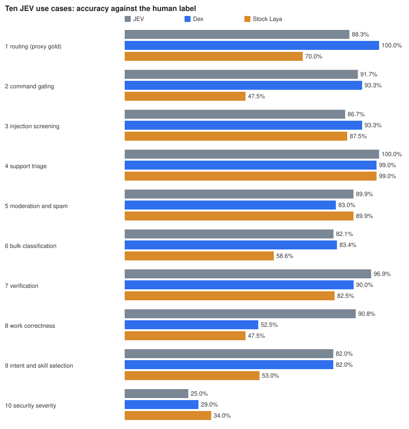
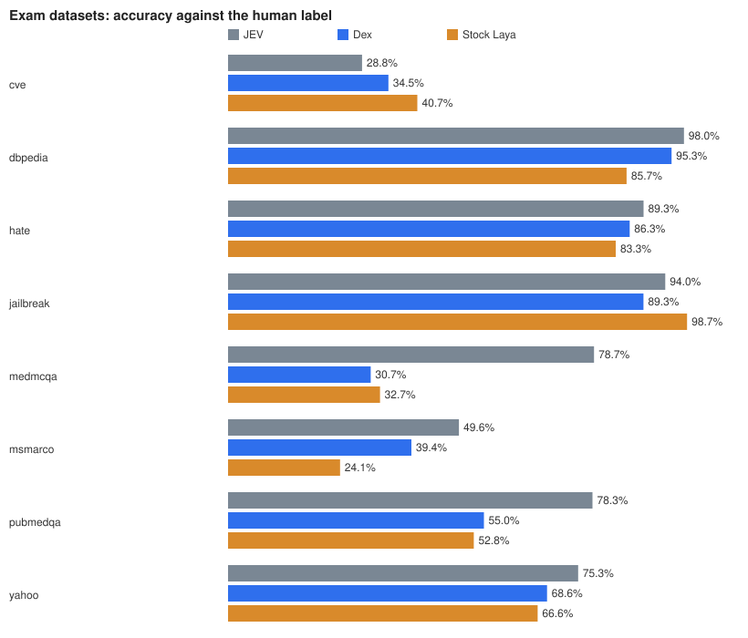

# Dex benchmark report

Dex against JEV and stock Laya, scored against the original human labels. Run on 2026-10-08 and 2026-10-09 on one NVIDIA RTX 3070 Ti (8 GB). Regenerate every table here with `python benchmarks/report.py`.

## Setup

- **Same prompts, same format.** Every system gets byte-identical requests in the Jev format (`state` plus typed `questions`). Local models answer through `laya.Agent.system_one` (Dex with its encoder in bfloat16; stock Laya as shipped, 512-token layout). JEV answers are real answers of the Jev API (`jev-latest`), collected from the Jev API; nothing is cited from third parties.
- **Scoring.** A choice question is right if the top option equals the human label; yes/no if the probability is on the right side of 0.5; a score question if the most likely level is the human level. Intervals are Wilson 95%.
- **Test A, ten use cases (1,244 questions).** The ten uses most often cited for Jev: model/tier routing, command gating, prompt-injection screening, support triage, moderation and spam, bulk classification, answer verification, work correctness, intent and skill selection, security severity. Human labels from each dataset's own held-out test/validation split, or built from known facts (a correct vs a buggy solution; a right vs a swapped trivia answer; a benign command vs the same command with a destructive payload appended). Prompts found in any training data were dropped. Routing uses a proxy label (reasoning problems vs ordinary requests). Some of these datasets are also in the training data (other rows), so A is partly in-distribution.
- **Test B, tasks never trained on (1,737 questions, 161 tasks).** Whole Super-NaturalInstructions tasks held out: neither the task nor any of its rows was in training. Scored against the task's human answer.
- **Test C, exam (2,346 questions with a human label).** Eight datasets used nowhere else: DBpedia topics, Yahoo topics, hate speech (clear cases), jailbreak screening, MedMCQA, PubMedQA, MS MARCO passage ranking, CVE severity. Human labels rebuilt from the saved source rows.

## Results

## Accuracy against the human label

| test | questions | JEV | Dex | Stock Laya |
|---|---|---|---|---|
| A. Ten use cases | 1244 | 84.6% (83%-87%) | 81.5% (79%-84%) | 68.2% (66%-71%) |
| B. Tasks never trained on | 1737 | 84.5% (83%-86%) | 74.4% (72%-76%) | 63.0% (61%-65%) |
| C. Exam: 8 datasets never used | 2346 | 78.2% (76%-80%) | 63.8% (62%-66%) | 62.5% (61%-64%) |
| **All three** | 5327 | **81.8%** | **71.4%** | **64.0%** |

## A. Ten use cases

| use case | questions | JEV | Dex | Stock Laya |
|---|---|---|---|---|
| 1 routing (proxy gold) | 120 | 88.3% (81%-93%) | 100.0% (97%-100%) | 70.0% (61%-77%) |
| 2 command gating | 120 | 91.7% (85%-95%) | 93.3% (87%-97%) | 47.5% (39%-56%) |
| 3 injection screening | 120 | 86.7% (79%-92%) | 93.3% (87%-97%) | 87.5% (80%-92%) |
| 4 support triage | 100 | 100.0% (96%-100%) | 99.0% (95%-100%) | 99.0% (95%-100%) |
| 5 moderation and spam | 159 | 89.9% (84%-94%) | 83.0% (76%-88%) | 89.9% (84%-94%) |
| 6 bulk classification | 145 | 82.1% (75%-87%) | 83.4% (77%-89%) | 58.6% (50%-66%) |
| 7 verification | 160 | 96.9% (93%-99%) | 90.0% (84%-94%) | 82.5% (76%-88%) |
| 8 work correctness | 120 | 90.8% (84%-95%) | 52.5% (44%-61%) | 47.5% (39%-56%) |
| 9 intent and skill selection | 100 | 82.0% (73%-88%) | 82.0% (73%-88%) | 53.0% (43%-62%) |
| 10 security severity | 100 | 25.0% (18%-34%) | 29.0% (21%-39%) | 34.0% (25%-44%) |

## C. Exam datasets, one by one (accuracy against the human label)

| dataset | questions | JEV | Dex | Stock Laya |
|---|---|---|---|---|
| cve | 177 | 28.8% (23%-36%) | 34.5% (28%-42%) | 40.7% (34%-48%) |
| dbpedia | 300 | 98.0% (96%-99%) | 95.3% (92%-97%) | 85.7% (81%-89%) |
| hate | 234 | 89.3% (85%-93%) | 86.3% (81%-90%) | 83.3% (78%-88%) |
| jailbreak | 299 | 94.0% (91%-96%) | 89.3% (85%-92%) | 98.7% (97%-99%) |
| medmcqa | 300 | 78.7% (74%-83%) | 30.7% (26%-36%) | 32.7% (28%-38%) |
| msmarco | 137 | 49.6% (41%-58%) | 39.4% (32%-48%) | 24.1% (18%-32%) |
| pubmedqa | 600 | 78.3% (75%-81%) | 55.0% (51%-59%) | 52.8% (49%-57%) |
| yahoo | 299 | 75.3% (70%-80%) | 68.6% (63%-74%) | 66.6% (61%-72%) |

## When a model and JEV disagree, who is right?

| model | both right | JEV only | model only | both wrong | of the disagreements, the model is right |
|---|---|---|---|---|---|
| Dex | 3477 | 878 | 326 | 646 | 27% |
| Stock Laya | 3038 | 1317 | 371 | 601 | 22% |

## Is the confidence honest? (all three tests together)

| system | accuracy | calibration error (lower is better) | sure (90%+): share of questions | sure (90%+): accuracy there |
|---|---|---|---|---|
| JEV | 81.8% | 0.052 | 63% | 94.5% |
| Dex | 71.4% | 0.058 | 29% | 93.2% |
| Stock Laya | 64.0% | 0.092 | 33% | 88.7% |

## What helped (accuracy against the human label)

| model | A. Ten use cases | B. Tasks never trained on | C. Exam datasets |
|---|---|---|---|
| Stock Laya | 68.2% (66%-71%) | 63.0% (61%-65%) | 62.5% (61%-64%) |
| ModernBERT body, 285 task wordings | 81.4% (79%-83%) | 65.2% (63%-67%) | 60.8% (59%-63%) |
| ModernBERT body, 1,080 task wordings | 80.4% (78%-82%) | 69.2% (67%-71%) | 61.3% (59%-63%) |
| Dex | 81.5% (79%-84%) | 74.4% (72%-76%) | 63.8% (62%-66%) |

## Speed and memory (NVIDIA GeForce RTX 3070 Ti, median / 95th percentile in ms per call)

| call | Dex | Stock Laya | JEV API |
|---|---|---|---|
| short text, 1 question | 18 / 19 | 19 / 19 | 886 / 932 |
| short text, 3 questions | 24 / 24 | 20 / 20 | - |
| short text, 5 questions | 33 / 34 | 22 / 23 | 855 / 890 |
| short text, 10 questions | 62 / 63 | 35 / 37 | - |
| short text, 15 questions | 95 / 97 | 47 / 48 | 780 / 804 |
| long text, 1 question | 72 / 73 | 26 / 27 | - |
| long text, 3 questions | 188 / 190 | 61 / 63 | - |
| long text, 5 questions | 305 / 308 | 95 / 96 | - |
| long text, 10 questions | 590 / 593 | 179 / 181 | - |
| long text, 15 questions | 878 / 884 | 260 / 262 | - |

GPU memory after loading: Dex 2.41 GB, Stock Laya 1.69 GB. Weights on disk: Dex 2379 MB, Stock Laya 843 MB.

## Answer-order check (400 multiple-choice questions, asked twice: as written and with the options reversed)

| system | picks a different option when the order is reversed | accuracy as written | accuracy reversed |
|---|---|---|---|
| JEV | 3.0% | 89.0% | 87.5% |
| Dex | 7.0% | 81.2% | 81.5% |
| Stock Laya | 25.2% | 65.2% | 66.2% |

## Reading the results

- **Everyday sorting and screening is close to JEV.** On test A Dex is 3.1 points behind JEV and 13.3 ahead of stock Laya. On command gating (93.3%), routing, bulk classification, intent selection and topic sorting it is level with JEV or within a few points.
- **Knowledge is the gap.** MedMCQA 30.7% vs 78.7%, PubMedQA 55.0% vs 78.3%, MS MARCO 39.4% vs 49.6%. Every local model sits near chance on MedMCQA even after task training: that training teaches the format, not the facts.
- **JEV is not always the reference.** On CVE severity from the description, JEV scores 28.8%, below both local models. When Dex and JEV disagree, Dex is right 27% of the time and both are wrong in a further 646 of 5,327 questions.
- **Stock Laya wins in two places.** Jailbreak screening (98.7% vs 89.3%) and moderation/spam (89.9% vs 83.0%). Task training did not help there.
- **Answer order.** Reversing the options changes Dex's pick 7.0% of the time against 25.2% for stock Laya and 3.0% for JEV.
- **Speed.** One question: 18 ms (Laya 19 ms, Jev API 886 ms). Many questions or long texts cost more with the 1.1B body: 15 questions on a short text 95 ms (Laya 47 ms), on a 900-token text 878 ms (Laya 260 ms). The Jev API stays near 800 ms.
- **Confidence is honest but less often given.** Calibration error 0.058 (JEV 0.052, stock Laya 0.092). When Dex says 90%+ it is right 93.2% of the time; it says so on 29% of questions, JEV on 63%.

## What helped

A first tuned model on a ModernBERT body saw 285 distinct task wordings. Research on instruction tuning (FLAN, T0, Super-NaturalInstructions, "Instruction Diversity Drives Generalization To Unseen Tasks") finds generalisation to unseen tasks follows the number of distinct instructions. Widening to about 1,080 wordings raised never-trained-task accuracy from 65.2% to 69.2%; moving to the 1.1B Ettin body raised it to 74.4%. The exam datasets moved little (60.8%, 61.3%, 63.8%) because that gap is knowledge, which neither change adds.

## Not measured

Run-to-run variation (one training run), languages other than English, inputs over 1,792 tokens, more than 30 options, throughput under concurrent load, and any task outside the three tests above.

## Method notes

Prompts and human labels are in `benchmarks/data`; Dex's and stock Laya's answers and JEV's results as summary numbers are in `benchmarks/results`. `python benchmarks/report.py` rebuilds every table here.

## Jev Decision Index (self-run, 2026-10-09)

Dex through the [Decision Index](https://huggingface.co/spaces/multimodalart/jev-decision-index) edition-0.3 harness, run by us on one RTX 3070 Ti over ~4.4 hours (140,620 requests: 125,443 answered, 15,177 unsupported). Served over HTTP from `server/dex_server.py`; unmodified state and questions per request. Skill **12.99**, raw 32.47. Median latency 27.5 ms (p95 331 ms).

| area | benchmarks | skill | raw | coverage |
|---|---|---|---|---|
| Knowledge & Reasoning | 11 | 7.42 | 30.29 | 98.7% |
| Language Understanding | 9 | 14.16 | 33.28 | 93.4% |
| Retrieval & Classification | 6 | 16.19 | 35.16 | 80.8% |
| Tools & Automation | 5 | 18.47 | 27.67 | 75.7% |
| Arts & Human Taste | 6 | 7.94 | 39.41 | 83.3% |
| **Full (balanced)** | **37** | **12.99** | **32.47** | **89.2%** |

For context, official board scores (2026-10-07 snapshot) around us:

| model | params | board skill |
|---|---|---|
| this-that 1.2 | 1.88B | 24.56 |
| jiwo 0.8B | 870M | 24.32 |
| EXAONE-4.0-1.2B-JEV | 1.28B | 23.31 |
| Bekko System One 400M | 400M | 15.24 |
| **Dex (self-run, not board)** | **1.1B** | **12.99** |
| Tev1-0.8B-experimental | 873M | 12.02 |
| Laya | ~420M | 4.43 |
| Jev (reference) | - | 60.11 |

Read this honestly: the official Full score is 20% public benchmarks plus 50% private same-skill tests and 30% private new-domain tasks, and the private parts cannot be self-run — so our number is not directly comparable to board numbers, and Dex is not on the board until the maintainer evaluates it. The biggest drag on our score is coverage, not accuracy: ~11% unsupported (long texts past 1,792 tokens; API-Bank entirely unanswered), and the index counts unanswered as wrong.
