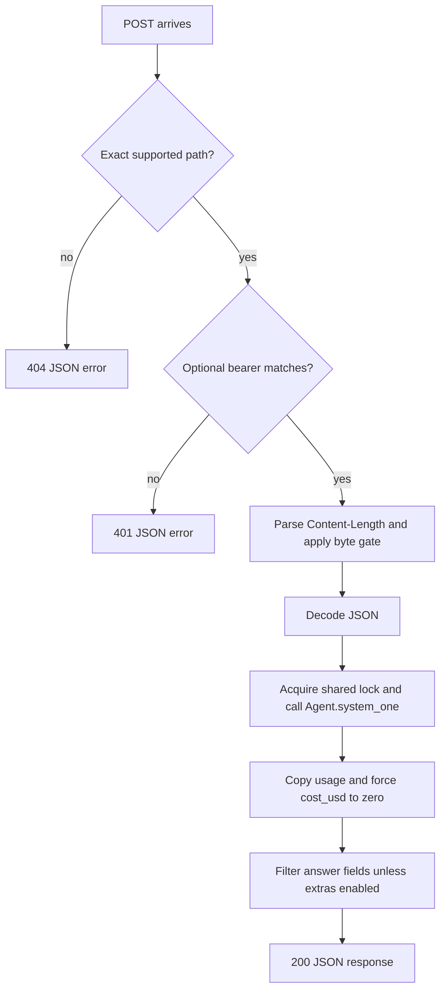

# Architecture and request lifecycle

Dex's authored server is one module around an external scoring runtime. Model architecture/training statements are release claims, not reimplemented here. [Repository map](developer-guide/repository.md) names every authored executable module.

## Startup

1. Import Torch/Laya and capture `DEX_MODEL`, `DEX_TOKEN` and `DEX_EXTRAS` as module state.
2. Parse first positional port, default 18766.
3. `load()` creates `Agent(model_dir, device="cpu")`, converts the encoder to bfloat16, then moves the model to CUDA only if exact `DEX_DEVICE=cuda` and CUDA is available.
4. Run one synthetic yes/no warm-up.
5. Bind `ThreadingHTTPServer` to `DEX_HOST`, default `127.0.0.1`, and serve.

Loading/warm-up happen before listening. A definition on disk is not proof this lifecycle completed. The health dtype is a fixed advertised string, not an independent runtime measurement.

## Request flow

Text equivalent: route check precedes auth; numeric length must be 1–1,000,000 bytes. JSON parsing and the locked runtime call catch only ValueError/KeyError/TypeError as 422. Usage copying and answer shaping happen afterwards. Malformed length and other exceptions are not guaranteed JSON errors. See [HTTP reference](reference/http.md).

## Threading and data ownership

HTTP handlers may be threaded, but a single `threading.Lock` surrounds scoring. Reading/decoding a body occurs before the lock. This is serialized model access, not measured concurrent throughput or a bounded request queue.

Request text passes to the selected Laya runtime. No authored request persistence is present; access log output is suppressed. That does not prove dependencies, process memory or exception text cannot expose sensitive input. [Security](concepts/security-and-compatibility.md) covers that boundary.

## Saved-report flow is separate

The reporter joins saved prompt/gold rows and model answers, chooses labels, skips missing/error predictions, computes counts/intervals/calibration, injects Jev summaries and reads saved speed/order values. It writes tables/charts, not model state. GPU scripts load models to make new measurements; the report does not automatically promote their rerun filenames.

## Change at the owning layer

HTTP routes, body gate, auth and answer filtering belong to the adapter. Input tokenization/scoring and detailed type validation belong to Laya. Weights/training provenance belong to the release owner. Measured claims belong to scoped evidence. Change [the adapter](developer-guide/change-the-adapter.md) or [evaluation](developer-guide/maintain-evaluation.md) with those boundaries intact.
